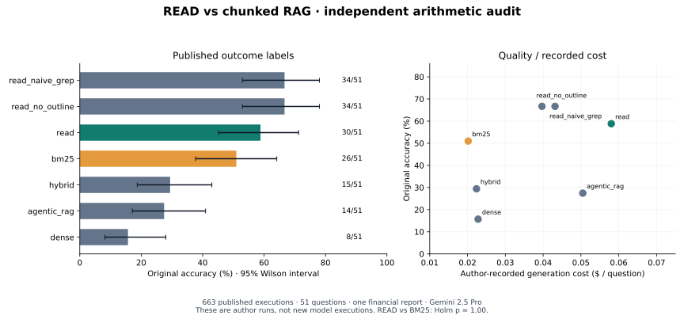

# READ vs RAG · Evidence Lab

**Español** · [English](README.md)

[](https://entropyweaver.github.io/READ-vs-RAG/?lang=es)

Elige una respuesta y compara READ y RAG por chunks en tres casos reales. [Abrir en local](docs/debugger/README.md).

**¿Cuándo compensa que un agente busque y lea un documento completo, frente a recuperar chunks?**

Laboratorio Python para investigar la afirmación de The Batch sobre
[READ / Beyond Top-K](https://arxiv.org/abs/2608.06305). Incluye un reanálisis verificable
de los datos publicados y un runner independiente para nuevas comparaciones.

## Estudio con llamadas reales a OpenAI

El estudio compara seis variantes con GPT-5.4 mini sobre 36 preguntas del Volumen I de
las cuentas de Gujarat 2024–25. Son **216 evaluaciones pareadas** en un informe de 94 páginas.

| Sistema | Aciertos | Latencia mediana | USD/pregunta |
|---|---:|---:|---:|
| READ | 27/36 (75,0 %) | 68,5 s | 0,0072 |
| Híbrido BM25 + BGE | 24/36 (66,7 %) | 13,6 s | 0,0092 |
| BM25 | 21/36 (58,3 %) | 13,0 s | 0,0096 |
| BM25 iterativo | 19/36 (52,8 %) | 25,1 s | 0,0065 |
| BGE, chunks largos | 18/36 (50,0 %) | 13,2 s | 0,0097 |
| BGE, chunks cortos | 14/36 (38,9 %) | 14,0 s | 0,0099 |

La latencia se mide sobre respuestas válidas durante ejecuciones concurrentes.
La diferencia entre READ y el híbrido fue de 8,3 puntos porcentuales (IC pareado del 95 %
de −11,1 a +27,8). La muestra corresponde a un informe y un modelo.

[Informe del estudio](studies/gujarat-volume-i/results/report.md) ·
[CSV por pregunta](studies/gujarat-volume-i/results/per_question.csv) ·
[Reproducción](studies/gujarat-volume-i/README.md)

[Segundo estudio](studies/selector/README.md) · Un selector híbrido → READ, una reproducción en Gujarat y un protocolo de evaluación en Haryana y Tripura.

## Auditoría de los resultados publicados

Recalculamos **663 ejecuciones publicadas** por los autores en el estudio original.
El código local permite reproducir la auditoría y ejecutar nuevas comparaciones.



Resultados recalculados desde las filas originales, conservando sus etiquetas:

| Sistema | Aciertos / 51 | Accuracy | Coste registrado por pregunta |
|---|---:|---:|---:|
| READ sin outline | 34 | 66,7% | $0,0397 |
| READ con grep literal | 34 | 66,7% | $0,0431 |
| READ | 30 | 58,8% | $0,0580 |
| BM25 | 26 | 51,0% | $0,0202 |
| Híbrido publicado | 15 | 29,4% | $0,0224 |
| RAG denso agéntico | 14 | 27,5% | $0,0505 |
| RAG denso | 8 | 15,7% | $0,0228 |

El mejor RAG denso del barrido publicado alcanza **35,3%**. READ vs BM25 tiene
13 victorias y 9 derrotas en pares discordantes, **p de Holm = 1,00**: estos datos no
demuestran superioridad frente a BM25. Tampoco demuestran equivalencia.
Costes y latencias son los registrados por los autores para generación, no mediciones
de nuestra máquina ni el coste total de conversión, indexación y evaluación.

La auditoría identifica **9 abstenciones** en la matriz principal que el juez acepta
y el detector por regex penaliza. Se muestran los textos y ambas etiquetas;
no se sustituyen automáticamente por una supuesta verdad corregida.

- [Informe con intervalos, comparaciones y limitaciones](reports/paper_audit/report.md)
- [Explorador HTML descargable](reports/paper_audit/index.html) — abrir localmente; GitHub no ejecuta el HTML
- [Estadísticas completas](reports/paper_audit/audit.json) · [CSV por pregunta](reports/paper_audit/per_question.csv)
- [Casos para revisión](reports/paper_audit/review_queue.jsonl) · [Desgloses](reports/paper_audit/slices.csv)

## Empezar sin gastar en modelos

Python **3.12+**. Desde la raíz del repositorio:

```bash
python -m venv .venv
# Windows PowerShell: .venv\Scripts\Activate.ps1
# Linux/macOS: source .venv/bin/activate
python -m pip install -e ".[dev]"
python -m read_vs_rag fetch-upstream  # una descarga inicial, hashes verificados
python -m unittest discover -s tests -v
python -m read_vs_rag audit
python -m read_vs_rag smoke
python -m read_vs_rag plan --limit 3
```

La auditoría y los tests usan solo la biblioteca estándar. Los dos logs originales
se descargan una vez (4 MB en total) desde un commit fijo, con verificación SHA-256;
después, la auditoría funciona sin red. Los informes calculados sí están incluidos. `smoke` ejecuta búsquedas
y BM25 reales sobre 16 preguntas sintéticas, sin generador: valida la implementación,
no mide rendimiento generativo de READ. `plan` no llama APIs ni descarga modelos.

## Nuevas ejecuciones

El runner admite OpenAI y Gemini. Para OpenAI, el piloto fija GPT-5.4 mini y usa
el mismo modelo para READ y BM25. La API cuenta los tokens de entrada antes de cada
generación y devuelve el uso real para calcular el coste. El adaptador solicita
`store: false` y conserva el estado entre turnos en memoria.

```powershell
python -m read_vs_rag plan --provider-config configs/openai-mini.json --limit 3
$secret = Read-Host "OpenAI API key" -AsSecureString
$env:OPENAI_API_KEY = [System.Net.NetworkCredential]::new("", $secret).Password
Remove-Variable secret
python -m read_vs_rag run --provider-config configs/openai-mini.json --limit 3 --output runs/openai-pilot-001
Remove-Item Env:OPENAI_API_KEY
```

Una clave de proyecto debe permitir generar en `POST /v1/responses` y contar
en `POST /v1/responses/input_tokens`. El piloto ejecuta seis celdas sobre tres
preguntas sintéticas. Puedes usar `--provider-config configs/openai-mini.json` con
`configs/matrix.example.json` para aplicar el mismo generador a la matriz ampliada.
Los embeddings BGE siguen ejecutándose localmente. Para probar otro modelo, prepara
un JSON con su modelo, parámetros y tarifas, y usa otro directorio de ejecución.
Los IDs de repetición se registran, ya que Responses no admite una semilla de muestreo.

El comando `judge` toma por defecto el proveedor de la ejecución. Su opción
`--provider-config` permite evaluar con otro modelo y mantiene su presupuesto separado.

La configuración original usa **Gemini**, como el paper. La clave solo se lee de
`GEMINI_API_KEY`, nunca de los archivos de configuración. Para establecerla sin
escribirla en el historial de PowerShell:

```powershell
$secret = Read-Host "Gemini API key" -AsSecureString
$env:GEMINI_API_KEY = [System.Net.NetworkCredential]::new("", $secret).Password
python -m read_vs_rag run --config configs/pilot.json --split dev --limit 3 --output runs/pilot-001
python -m read_vs_rag report runs/pilot-001
```

El piloto usa READ y BM25 sobre fixtures y reserva un máximo estimado de **$3 para
la ejecución completa**. Es una prueba de integración. Para un experimento real,
sustituye corpus y preguntas siguiendo [el formato de datos](docs/DATA.md).
El coste usa las tarifas configuradas; no es un límite de facturación del proveedor.

```bash
# Matriz ampliada: descarga pesos de embeddings/reranker al ejecutar, no al planificar.
python -m pip install -e ".[dense]"
python -m read_vs_rag plan --config configs/matrix.example.json
python -m read_vs_rag run --config configs/matrix.example.json --split dev --output runs/matrix-dev-001

# Evaluación semántica opcional; otra partida de gasto, separada de la generación.
python -m read_vs_rag judge runs/pilot-001 --max-cost-usd 1
python -m read_vs_rag report runs/pilot-001
```

El piloto y los ejemplos de `configs/` usan datos sintéticos por defecto. Para trabajar
con el informe de Gujarat, sigue los [pasos del estudio](studies/gujarat-volume-i/README.md).

La documentación de Google consultada el 17-11-2026 anuncia que `gemini-2.5-pro`
se redirigirá a otro modelo el 1-12-2026. Por eso las tarifas de ejemplo caducan
el 30-11 y el runner verifica `modelVersion`. Después hay que verificar un modelo y
sus tarifas, ajustar el config y abrir una nueva carpeta de ejecución. No cambiar
solo la fecha para ocultar la migración. [Fuente oficial](https://ai.google.dev/gemini-api/docs/pricing#gemini-2.5-pro).

## Comparadores implementados

| Variante | Acceso a la evidencia | Propósito |
|---|---|---|
| `read` | `memory_list`, `memory_grep`, `memory_outline`, `memory_read` | Implementación independiente inspirada en READ |
| `read_naive_grep` | Búsqueda literal, sin normalización | Ablación de normalización |
| `read_no_outline` | Sin índice de encabezados | Ablación de navegación |
| `bm25` | Chunks, búsqueda léxica | Baseline imprescindible |
| `dense` | BGE fijado a un commit | RAG denso real, sin sustituto TF-IDF |
| `dense_naive_chunks` | Sin arrastre de contexto | Efecto del chunker |
| `hybrid` | BM25 + BGE mediante RRF | Recuperación combinada |
| `hybrid_rerank` | RRF + BGE cross-encoder | Baseline reforzado |
| `agentic_dense` | Mismo bucle y límites; herramienta vectorial | Separar interfaz de iteración |
| `full_context` | Todo el corpus | Control; rechaza truncamiento silencioso |
| `oracle` | Líneas gold ± margen | Techo diagnóstico; **usa etiquetas**, nunca rival real |

Las operaciones READ se exponen directamente al modelo; no requieren MCP. El chunker
contextual conserva líneas completas, encabezados Markdown y declaraciones de unidad;
no es una copia del chunker de los autores. Esta matriz estudia el mecanismo,
**no es una reproducción exacta del paper**. La [ruta de reproducción oficial](docs/PROTOCOL.md#reproducción-exacta)
usa el código de TwoSpoon.

## Qué queda registrado

- Calidad: exactitud numérica con unidades, respuestas exactas/alias, abstención explícita,
  juez semántico ciego al nombre del sistema y soporte de afirmaciones como señal separada.
- Recuperación: cobertura de líneas, cobertura de todos los apoyos, hit/recall de chunks,
  MRR y nDCG para recuperación de una sola pasada. Las anotaciones son una referencia incompleta.
- Citas: validez de coordenadas, líneas realmente vistas y solapamiento con evidencia anotada.
  Estas métricas no se llaman «faithfulness».
- Recursos: latencia p50/p95/p99, tokens de entrada/salida/razonamiento, llamadas, coste,
  gasto del juez y tiempo de indexación por separado; reservas desconocidas tras errores.
- Inferencia: Wilson con una repetición, bootstrap por pregunta, McNemar exacto y Holm cuando
  proceden. Las repeticiones no se cuentan como preguntas independientes.
- Trazabilidad: respuestas, resultados de herramientas, parámetros, corpus y preguntas con hash,
  versiones de librerías, código y modelo devuelto, errores y celdas pendientes visibles.

Reejecutar el mismo comando reanuda las celdas pendientes. Código, configuración,
dataset o dependencias distintos requieren un nuevo directorio. Los errores solo se
reintentan con `--retry-errors`, conservando el gasto previo. Un JSONL roto se rechaza
para repararlo explícitamente. Se bloquean dos procesos que escriban la misma ejecución.

## Diseño y desarrollo

- [Protocolo experimental y limitaciones](docs/PROTOCOL.md)
- [Dataset, anotaciones y revisión humana](docs/DATA.md)
- [Métricas: definición y denominadores](docs/METRICS.md)
- [Verificación y lo que aún no se ha probado](docs/VALIDATION.md)

```bash
ruff check .
python -m unittest discover -s tests -v
# Opcional: regenerar figuras con matplotlib
python -m pip install -e ".[plots]"
python scripts/plot_audit.py
```

La CI está configurada para Python 3.12 en Linux y Windows, sin claves ni llamadas
facturables. Los datos descargados para nuevos experimentos, índices, claves y `runs/`
están excluidos de Git. No hay un servidor desplegado ni analítica externa.

MIT. Material de terceros y atribución: [THIRD_PARTY_NOTICES.md](THIRD_PARTY_NOTICES.md).
