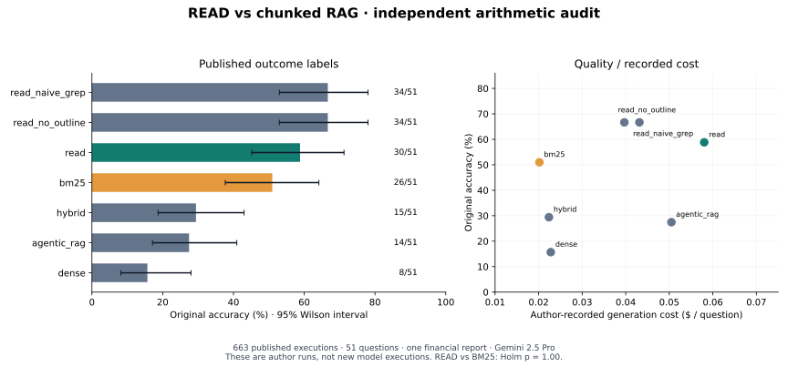

# READ vs RAG · Evidence Lab

**English** · [Español](README.es.md)

[](https://entropyweaver.github.io/READ-vs-RAG/)

Pick an answer, then compare READ and chunked RAG in three recorded cases. [Run locally](docs/debugger/README.md).

**When does it pay to let an agent search and read a document directly instead of retrieving chunks?**

This Python lab investigates The Batch's coverage of [READ / Beyond Top-K](https://arxiv.org/abs/2608.06305).
It includes a reproducible audit of the published data and an independent runner for new comparisons.

## Live OpenAI study

The study compares six variants with GPT-5.4 mini on 36 questions about Volume I of the
2024–25 Gujarat Finance Accounts. It covers **216 paired evaluations** on a 94-page report.

| System | Correct answers | Median latency | USD/question |
|---|---:|---:|---:|
| READ | 27/36 (75.0%) | 68.5 s | 0.0072 |
| BM25 + BGE hybrid | 24/36 (66.7%) | 13.6 s | 0.0092 |
| BM25 | 21/36 (58.3%) | 13.0 s | 0.0096 |
| Iterative BM25 | 19/36 (52.8%) | 25.1 s | 0.0065 |
| BGE, longer chunks | 18/36 (50.0%) | 13.2 s | 0.0097 |
| BGE, shorter chunks | 14/36 (38.9%) | 14.0 s | 0.0099 |

Latency is measured on valid responses during concurrent runs. READ scored 8.3 percentage
points above the hybrid (95% paired CI: −11.1 to +27.8). The study covers one report and one model.

[Study report (Spanish)](studies/gujarat-volume-i/results/report.md) ·
[Per-question CSV](studies/gujarat-volume-i/results/per_question.csv) ·
[Reproduction guide (Spanish)](studies/gujarat-volume-i/README.md)

[Follow-up study](studies/selector/README.md) · A hybrid-to-READ selector, a replay on Gujarat and a held-out protocol for Haryana and Tripura.

## Audit of the published results

We recomputed the metrics for **663 published runs** from the original study, using the authors' labels.



| System | Correct / 51 | Accuracy | Recorded cost per question |
|---|---:|---:|---:|
| READ without outline | 34 | 66.7% | $0.0397 |
| READ with literal grep | 34 | 66.7% | $0.0431 |
| READ | 30 | 58.8% | $0.0580 |
| BM25 | 26 | 51.0% | $0.0202 |
| Published hybrid | 15 | 29.4% | $0.0224 |
| Agentic dense RAG | 14 | 27.5% | $0.0505 |
| Dense RAG | 8 | 15.7% | $0.0228 |

The best dense RAG configuration in the published sweep reached **35.3%**. READ beat BM25
on 13 questions where the methods disagreed, and BM25 won on 9 (Holm-adjusted p = 1.00).
These data establish neither superiority nor equivalence. The published cost and latency figures
cover answer generation and exclude conversion, indexing, and evaluation.

The audit also found **nine abstentions** in the main matrix that the judge accepted and the regex
detector penalized. Both labels and the response text are available for review.

- [Audit report with intervals, comparisons, and limitations (Spanish)](reports/paper_audit/report.md)
- [HTML explorer](reports/paper_audit/index.html) (download and open locally)
- [Full statistics](reports/paper_audit/audit.json) · [Per-question CSV](reports/paper_audit/per_question.csv)
- [Cases for review](reports/paper_audit/review_queue.jsonl) · [Breakdowns](reports/paper_audit/slices.csv)

## Get started without paid model calls

Use **Python 3.12+**. Run these commands from the repository root.

```bash
python -m venv .venv
# Windows PowerShell: .venv\Scripts\Activate.ps1
# Linux/macOS: source .venv/bin/activate
python -m pip install -e ".[dev]"
python -m read_vs_rag fetch-upstream  # One-time download with hash verification
python -m unittest discover -s tests -v
python -m read_vs_rag audit
python -m read_vs_rag smoke
python -m read_vs_rag plan --limit 3
```

The audit and tests use the standard library. `fetch-upstream` downloads two logs (4 MB total)
from a pinned commit and verifies their SHA-256 hashes. Once downloaded, the audit works offline.
The computed reports are included in the repository. `smoke` runs real retrieval and BM25 on 16
synthetic questions to check the implementation. `plan` inspects the run without calling APIs or
fetching model weights.

## Run a new comparison

The runner supports OpenAI and Gemini. The OpenAI pilot pins GPT-5.4 mini and uses the same
model for READ and BM25. The adapter counts input tokens before generation, calculates costs
from reported usage, requests `store: false`, and keeps turn history in memory.

```powershell
python -m read_vs_rag plan --provider-config configs/openai-mini.json --limit 3
$secret = Read-Host "OpenAI API key" -AsSecureString
$env:OPENAI_API_KEY = [System.Net.NetworkCredential]::new("", $secret).Password
Remove-Variable secret
python -m read_vs_rag run --provider-config configs/openai-mini.json --limit 3 --output runs/openai-pilot-001
Remove-Item Env:OPENAI_API_KEY
```

Use a project key that can generate at `POST /v1/responses` and count input tokens at
`POST /v1/responses/input_tokens`. The pilot runs six cells on three synthetic questions.
Apply `--provider-config configs/openai-mini.json` to `configs/matrix.example.json` to use the
same generator for the extended matrix. BGE embeddings run locally. To try a different model,
prepare a JSON file with its model ID, settings, and rates and use a new run directory. The runner
records repeat IDs. Responses does not expose a sampling seed.

By default, `judge` uses the run's provider. Use `--provider-config` to select a different judge
model. Judging has its own budget.

The original configuration uses Gemini, as the paper did. The runner reads the key from
`GEMINI_API_KEY`. In PowerShell, you can set it without typing the value into command history.

```powershell
$secret = Read-Host "Gemini API key" -AsSecureString
$env:GEMINI_API_KEY = [System.Net.NetworkCredential]::new("", $secret).Password
python -m read_vs_rag run --config configs/pilot.json --split dev --limit 3 --output runs/pilot-001
python -m read_vs_rag report runs/pilot-001
```

The pilot sets an estimated **$3 budget for the full run**. The estimate uses configured rates,
and provider billing may differ. To run on your own corpus, follow the [data format guide (Spanish)](docs/DATA.md).

```bash
# The extended matrix downloads embedding and reranker weights when run.
python -m pip install -e ".[dense]"
python -m read_vs_rag plan --config configs/matrix.example.json
python -m read_vs_rag run --config configs/matrix.example.json --split dev --output runs/matrix-dev-001

# Optional semantic evaluation with a separate budget.
python -m read_vs_rag judge runs/pilot-001 --max-cost-usd 1
python -m read_vs_rag report runs/pilot-001
```

The pilot and examples in `configs/` use synthetic data by default. For the Gujarat report,
follow the [study instructions (Spanish)](studies/gujarat-volume-i/README.md).

The Gemini example records the rates checked on November 17, 2026. Google announced that
`gemini-2.5-pro` would be routed to a different model on December 1, 2026, so the example rates
expire on November 30 and the runner checks `modelVersion`. For later runs, verify the model and
rates, update the configuration, and start a new run directory. [Google's pricing notes](https://ai.google.dev/gemini-api/docs/pricing#gemini-2.5-pro)

## Retrieval methods and controls

| Variant | Evidence access | What it tests |
|---|---|---|
| `read` | `memory_list`, `memory_grep`, `memory_outline`, `memory_read` | Independent implementation inspired by READ |
| `read_naive_grep` | Literal search | Effect of normalization |
| `read_no_outline` | Search and read with headings index disabled | Effect of document navigation |
| `bm25` | Lexical search over chunks | Lexical baseline |
| `dense` | BGE embeddings pinned to a commit | Dense RAG baseline |
| `dense_naive_chunks` | Chunks without carried-over context | Effect of the chunker |
| `hybrid` | BM25 and BGE combined with RRF | Hybrid retrieval |
| `hybrid_rerank` | RRF with BGE cross-encoder reranking | Reranking baseline |
| `agentic_dense` | Vector search tool with the same loop and limits | Effect of iterative retrieval |
| `full_context` | Entire corpus, declining inputs that would be truncated | Full context control |
| `oracle` | Annotated evidence lines with a surrounding margin | Diagnostic upper bound using gold labels |

The model calls READ's document tools directly. The contextual chunker preserves complete lines,
Markdown headings, and unit declarations. For an exact reproduction of the paper, follow the
[guide using TwoSpoon's original code (Spanish)](docs/PROTOCOL.md#reproducción-exacta).

## What the runner records

- **Answer quality** — Numeric accuracy with units, exact matches and aliases, explicit abstentions, and a semantic judge blinded to the system name. Claim support is scored separately.
- **Retrieval** — Coverage of annotated evidence lines, all-support coverage, chunk hits and recall, MRR, and nDCG for single-pass retrieval. Annotations cover a subset of possible evidence.
- **Citations** — Coordinate validity, whether the cited lines were available to the model, and overlap with annotated evidence.
- **Resources** — p50/p95/p99 latency, input/output/reasoning tokens, calls, estimated cost, pending reservations, and separate judge spending and indexing time.
- **Inference** — Wilson intervals for single-repeat runs, per-question bootstrap, exact McNemar tests, and Holm correction where applicable. Repeats are grouped by question.
- **Provenance** — Answers, tool results, configuration, corpus and question hashes, library and model versions, errors, and pending cells.

Rerunning the same command resumes pending cells. Changes to code, configuration, datasets, or
dependencies require a new run directory. `--retry-errors` retries failed cells and preserves prior
spending. Malformed JSONL requires explicit repair, and a run directory has a single writer.

## Design and development

- [Experimental protocol and limitations (Spanish)](docs/PROTOCOL.md)
- [Dataset, annotations, and human review (Spanish)](docs/DATA.md)
- [Metric definitions and denominators (Spanish)](docs/METRICS.md)
- [Initial validation and remaining limitations (Spanish)](docs/VALIDATION.md)

```bash
ruff check .
python -m unittest discover -s tests -v
# Optional: regenerate the audit figures.
python -m pip install -e ".[plots]"
python scripts/plot_audit.py
```

CI runs on Python 3.12 on Linux and Windows without credentials or billable model calls. Local
downloads, indexes, and new run outputs under `runs/` are excluded from Git.

MIT. See [third-party notices](THIRD_PARTY_NOTICES.md) for attribution.
