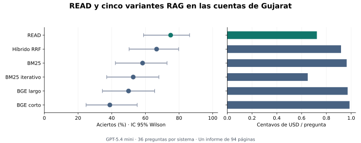

# Resultados de las llamadas reales a OpenAI

Se completaron 216 celdas pareadas sobre 36 preguntas del Volumen I de las cuentas de Gujarat 2024–25.
Se usó `gpt-5.4-mini-2026-03-17` en las seis variantes. Las configuraciones y las coordenadas de evidencia
están en la carpeta del estudio.

| Sistema | Aciertos | % (IC 95% Wilson) | Latencia p50 / p95 | USD/pregunta | Cobertura de líneas | Fallos operativos |
|---|---:|---:|---:|---:|---:|---:|
| READ | 27/36 | 75,0 (58,9–86,2) | 68,5 / 102,9 s | 0,0072 | 39,4% | 3 |
| Híbrido RRF | 24/36 | 66,7 (50,3–79,8) | 13,6 / 26,1 s | 0,0092 | 31,7% | 0 |
| BM25 | 21/36 | 58,3 (42,2–72,9) | 13,0 / 18,3 s | 0,0096 | 23,2% | 0 |
| BM25 iterativo | 19/36 | 52,8 (37,0–68,0) | 25,1 / 50,0 s | 0,0065 | 34,8% | 13 |
| BGE largo | 18/36 | 50,0 (34,5–65,5) | 13,2 / 14,6 s | 0,0097 | 22,8% | 0 |
| BGE corto | 14/36 | 38,9 (24,8–55,1) | 14,0 / 16,4 s | 0,0099 | 26,3% | 0 |

Las latencias y la cobertura se calculan sobre celdas con respuesta válida. El coste medio incluye
los fallos con uso recibido de la API. La cobertura excluye las preguntas sin líneas anotadas.
Las seis condiciones se ejecutaron en cuatro grupos con hasta ocho celdas simultáneas por grupo.
Por eso la latencia describe esta ejecución con carga compartida.

| READ menos comparador | Δ en puntos (IC bootstrap 95%) | Solo READ / solo comparador | p de Holm |
|---|---:|---:|---:|
| Híbrido RRF | 8,3 (-11,1 a 27,8) | 9 / 6 | 0,607 |
| BM25 | 16,7 (0,0 a 33,3) | 9 / 3 | 0,307 |
| BM25 iterativo | 22,2 (2,8 a 41,7) | 12 / 4 | 0,307 |
| BGE largo | 25,0 (0,0 a 47,2) | 15 / 6 | 0,307 |
| BGE corto | 36,1 (13,9 a 55,6) | 16 / 3 | 0,022 |

READ obtuvo la mayor puntuación. La ventaja se distinguió estadísticamente frente a BGE corto
tras corregir por cinco comparaciones. Frente a BM25 y al híbrido quedó incertidumbre considerable.
El recorte del encoder bajó de 67/130 chunks a 5/245 al cambiar de 1.500 caracteres y k=12 a 850 y k=16.
La puntuación bajó de 18 a 14 aciertos en esa variante. Cambiaron a la vez el tamaño y k, de modo
que esa diferencia no identifica el efecto causal de ninguno de los dos ajustes por separado.

## Fallos revisados

- En `lookup-016`, READ citó las líneas 5845–5848, que contienen tanto **148.743,95** crore,
  un subtotal, como **199.611,44** crore, el total pedido. Respondió con el subtotal. La cita
  válida y accesible no garantizó la interpretación correcta.
- En `agg-020`, READ y BM25 iterativo dieron el total y su desglose correcto. BM25 y BGE largo
  se abstuvieron. El híbrido devolvió el desglose de otra partida.
- Entre las tres preguntas sin respuesta, READ acertó una, atribuyó un dato de Gujarat a Maharashtra
  en otra y produjo JSON no válido en la tercera. BM25, ambos BGE y el híbrido acertaron las tres.
- READ tuvo tres errores de formato. BM25 iterativo agotó en 13 celdas el límite común de contexto
  de la pregunta. Los dos tipos de fallo se cuentan como errores. La política del runner detiene
  la celda al alcanzar ese límite, aunque exigir una respuesta con la evidencia reunida podría
  cambiar el resultado de esa variante.

## Gasto

- **1,8767 USD** de generación para las 216 celdas, según uso recibido y tarifas configuradas.
- **1,9226 USD** al incluir pilotos y calibración con uso recibido. Quedaron **0,0869 USD**
  reservados por peticiones interrumpidas o de resultado desconocido.
- **2,0095 USD** al sumar esas reservas. El importe de la factura lo determina el proveedor.

El piloto inicial detectó un requisito de JSON mode que la prueba simulada no cubría. Se corrigió
antes de la medición. Una calibración con 14.000 tokens de entrada rechazaba parte del contexto
de BM25 y se detuvo. La tabla usa la configuración posterior de 24.000 tokens en las seis variantes.

El estudio abarca una conversión de un documento con preguntas correlacionadas y una ejecución
por pregunta y sistema. El score mide valores, unidades y abstención. Se revisaron casos concretos
y no se hizo una evaluación semántica independiente de todas las respuestas.

[Métricas JSON](metrics.json) · [CSV por pregunta](per_question.csv) · [Reproducción](../README.md)
